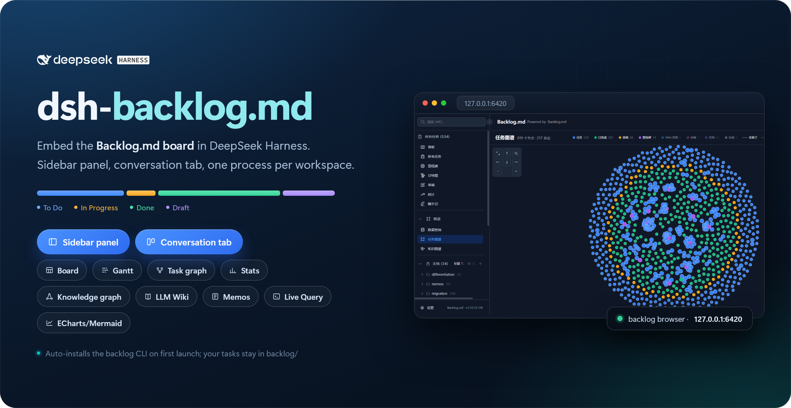
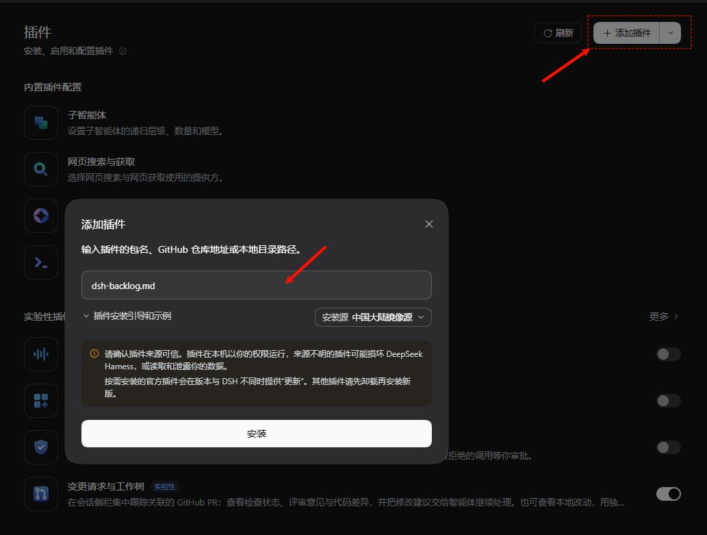
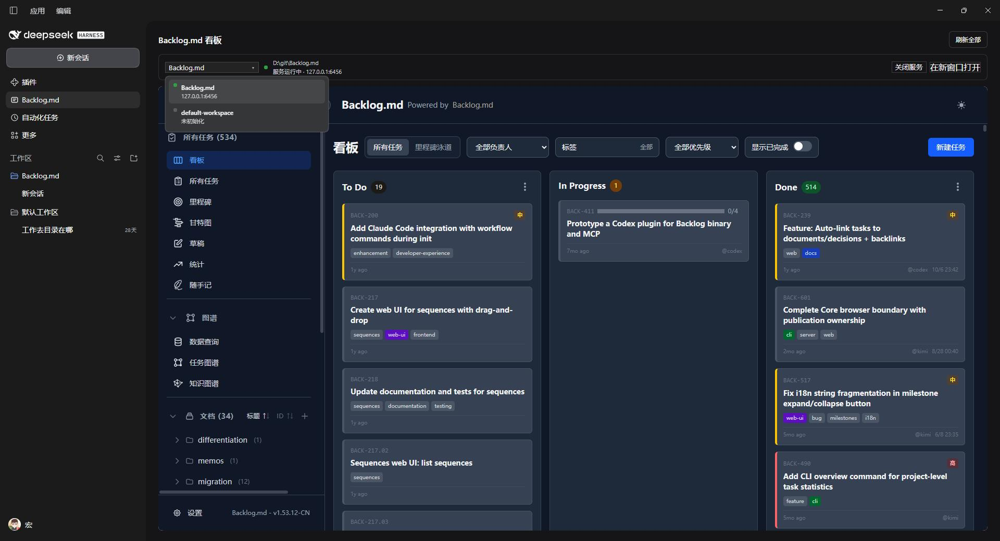
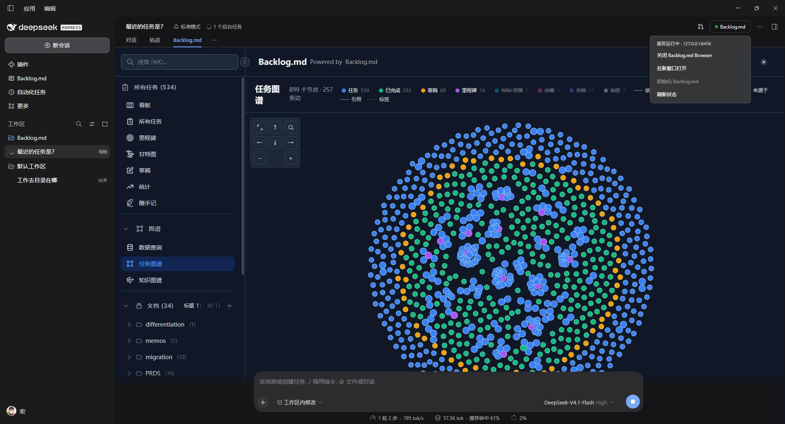
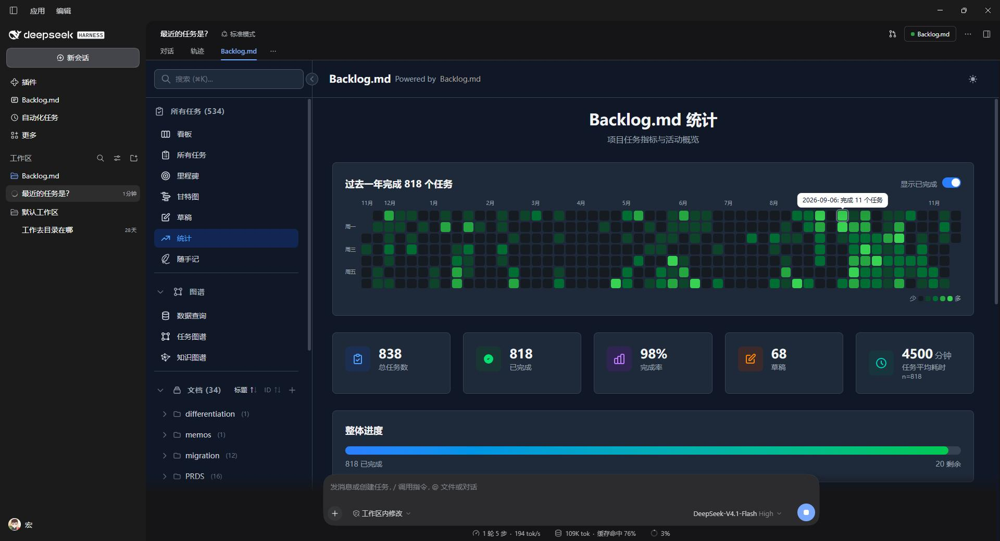

<a id="readme-top"></a>

<div align="center">

# dsh-backlog.md

### Embed the Backlog.md Markdown Kanban Board in DeepSeek Harness

A sidebar panel, a conversation-view tab, and a session-header menu — one `backlog browser` process per workspace.

[](https://www.npmjs.com/package/dsh-backlog.md)
[](https://www.npmjs.com/package/dsh-backlog.md)
[](https://github.com/kuwork/DSH-Backlog.md/blob/main/LICENSE)
[](https://nodejs.org)
[](https://github.com/kuwork/DSH-Backlog.md/stargazers)

[简体中文](https://github.com/kuwork/DSH-Backlog.md/blob/main/README.md) ｜ English

[Features](#features) ·
[What Is Backlog.md](#what-is-backlogmd) ·
[Quick Start](#quick-start) ·
[Screenshots](#screenshots) ·
[Three Entry Points](#three-entry-points) ·
[Installation Options](#installation-options) ·
[Configuration](#configuration) ·
[How It Works](#how-it-works) ·
[FAQ](#faq) ·
[Known Limitations](#known-limitations)

</div>



**dsh-backlog.md** is a DeepSeek Harness (DSH) bundle plugin that embeds the local web board of [Backlog.md](https://github.com/kuwork/Backlog.md) — a Git-native, Markdown-driven AI task manager — directly into the Harness UI through `backlog browser`: a `Backlog.md` panel in the sidebar, a `Backlog.md` tab in the conversation view, and a `Backlog.md` menu in the session header. Every workspace runs its own isolated board process with automatic port avoidance, and when the `backlog` CLI is missing from your machine, the plugin installs it automatically on first launch. No code changes to Harness itself are required.

> [!NOTE]
> npm package: [dsh-backlog.md](https://www.npmjs.com/package/dsh-backlog.md) ｜ Plugin repo: [github.com/kuwork/DSH-Backlog.md](https://github.com/kuwork/DSH-Backlog.md) ｜ Backlog.md repo: [github.com/kuwork/Backlog.md](https://github.com/kuwork/Backlog.md) ｜ Docs: [kuwork.github.io/Backlog.md](https://kuwork.github.io/Backlog.md/) ｜ Backlog CLI: `npm i -g @kuwork/backlog.md`

## Features

- 🧩 **Three embedded entry points**: a sidebar panel, a conversation-view tab, and a session-header menu covering cold-start board launch, in-session viewing, and process control — without touching a single line of Harness core code.
- 🗂️ **Per-workspace isolation**: each workspace gets its own `backlog browser` process and port, so starting and stopping never affects other workspaces; pressing "Start" repeatedly is idempotent and never spawns a second process.
- 🚀 **Zero-setup CLI**: if `backlog` cannot be found on first launch, the plugin runs `npm install --global @kuwork/backlog.md` once automatically (~200+ MB, cached afterward) and continues the startup.
- 🔌 **Smart port avoidance**: the starting port is spread by hashing the workspace's absolute path, then the next ports are tried on collision; the plugin also reads process stdout and follows the actual port the CLI switches to, showing an explicit "port in use, moved A → B" notice.
- 🧭 **Trustworthy init detection**: only the `backlog/` / `.backlog/` directory counts as evidence of initialization, and read failures surface their real cause instead of being misreported as "not initialized".
- 🎨 **Theme follows Harness automatically**: menus, modals, and panels are colored with Harness `--dsw-alias-*` design tokens, adapting to light/dark themes and theme switching; the plugin injects only one `bk-*` stylesheet.
- 🔒 **Local-first and auditable**: no network calls, no uploads, no credentials. The entire executable codebase consists of just two files, `index.js` and `client.js`, which you can read line by line before installing.
- ⚙️ **Configurable behavior**: set a custom executable path, disable auto-install, or tune the port window and readiness timeout — see [Configuration](#configuration).

## What Is Backlog.md

[Backlog.md](https://github.com/kuwork/Backlog.md) is a **Git-native AI task manager**: tasks, acceptance criteria, implementation plans, and execution records all live as Markdown files inside your own repository. AI agents (Claude Code, Codex, Gemini CLI, and others) pick up and advance tasks through the CLI / MCP, while humans review and approve at three checkpoints: **task description, implementation plan, and delivered result**.

- **Markdown Native**: one task is one `.md` file. There is no proprietary database — everything can be inspected with `git diff`, reviewed, and archived;
- **Git Native**: the `backlog/` tree (tasks / docs / decisions / wiki) is versioned in the same repository as your code;
- **Local & Offline First**: data stays on your machine — no cloud account or subscription required;
- **Built-in kanban board**: `backlog browser` serves a local web UI — and this plugin embeds that UI into the Harness conversation tab and sidebar.

This plugin does not modify Backlog.md; it is only a **host UI** for it, owning the board subprocess lifecycle, port allocation, same-origin routing, and UI embedding. For the full docs, visit [kuwork.github.io/Backlog.md](https://kuwork.github.io/Backlog.md/).

## Quick Start

Install with one command and refresh the DeepSeek Harness page to see the new entries:

```sh
dsh plugin --profile web add dsh-backlog.md
```

The `backlog` CLI is installed automatically when the board first starts — no manual setup needed. To pin a version, use `dsh-backlog.md@<version>`. For other sources (GitHub, a local path, or in-conversation install), see [Installation Options](#installation-options).

You can also install from the UI: open the **Plugins** page → click **+ Add plugin** in the top-right corner → enter the package name `dsh-backlog.md` → click **Install**, then refresh the page (the dialog also accepts a GitHub repo URL or an absolute local directory path; leave the install source at its default).



> [!TIP]
> Verify the install: run `dsh --profile web --dump-config`. A `# == dsh-backlog.md` section should appear in the output, and `Backlog.md` should show up in the sidebar after refreshing the page.

## Screenshots



*The sidebar `Backlog.md` panel works without an active conversation, so you can launch the board from a cold start. Each workspace row shows a status dot, its name, and the service address (e.g. `127.0.0.1:6486`); unconfigured workspaces read "Not initialized". The board of the selected workspace fills the right side — To Do / In Progress / Done columns, filters, and "New task" all run inside the iframe.*



*The **Task Graph** in the third conversation tab (Chat / Trajectory / **Backlog.md**), color-coded by task / milestone / doc / decision / wiki page. The session-header menu in the top-right shows service status and port, plus stop, open-in-new-window, initialize, and refresh actions.*



*The **Statistics** view in the same tab: a yearly completion heatmap, five metric cards (total / completed / completion rate / drafts / average task duration), and an overall progress bar. The whole tab is an iframe that fills the full height without taking up top toolbar space.*

## Three Entry Points

| Location | What you can do there |
|---|---|
| **Sidebar `Backlog.md` panel** | Works without a conversation. Workspace selector (status dot + service address per item), start / stop / open in new window / initialize, with the selected board filling the area below |
| **Conversation-view `Backlog.md` tab** | Shows a centered "Start Backlog.md Browser" prompt when stopped; after launch it becomes a full-page iframe with no top toolbar |
| **Session-header `Backlog.md` menu** | Service status and port (shows `A → B` on automatic port shifts), start / stop, open in new window, initialize, refresh status; read failures show their real cause instead of a false "not initialized" |

There is also a `backlog init` dialog for project name, backlog directory, config location, task ID prefix, AI integration mode, instruction files to write, and the Git toggle. On submit it runs in the **current workspace**.

## Installation Options

The recommended npm install is already covered in [Quick Start](#quick-start). The three alternatives below suit offline development and source debugging; all four paths are also available through **Plugins → + Add plugin**.

<details>
<summary><b>B. Install from GitHub</b></summary>

```sh
dsh plugin --profile web add github:kuwork/DSH-Backlog.md
```

This package has no build step, so pnpm build-script approval is never triggered.

</details>

<details>
<summary><b>C. Install from a local path (for development)</b></summary>

```sh
dsh plugin --profile web add <absolute-path>/backlog-plugin
```

</details>

<details>
<summary><b>D. Ask an agent to install it in chat (creative mode / cordis preset)</b></summary>

```
Use install_bundle of plugin_manager to install <absolute-path>/backlog-plugin
```

</details>

<details>
<summary><b>Release mechanism (for maintainers)</b></summary>

Releases are driven by Git tags: pushing a `v*.*.*` tag makes CI stamp the version from the tag, publish to npm, and sync `package.json` back to `main`. The npm page is [npmjs.com/package/dsh-backlog.md](https://www.npmjs.com/package/dsh-backlog.md).

</details>

## Prerequisites and CLI Auto-Install

**You normally do not need to install the `backlog` CLI manually.** On first board launch, if the CLI cannot be found locally, the plugin runs a global install once (`npm install --global @kuwork/backlog.md`, ~200+ MB, cached afterward) and then continues starting up. Install it manually only if you want to pin the version yourself or global installs are blocked on the machine:

```sh
npm i -g @kuwork/backlog.md
backlog --version
```

Full CLI documentation is available in the [Backlog.md repo](https://github.com/kuwork/Backlog.md) and on the [docs site](https://kuwork.github.io/Backlog.md/).

> [!WARNING]
> **Known pitfall (Windows native binary version mismatch)**: `@kuwork/backlog.md` ships native binaries through platform-specific optionalDependencies. If the reported version disagrees with the binary — symptoms are `backlog browser` exiting immediately with no output — reinstall with `npm i -g @kuwork/backlog.md --force` and verify that the version in `%APPDATA%\npm\node_modules\@kuwork\backlog.md-windows-x64\package.json` matches the CLI. To handle a failed auto-install or disable it, see `autoInstall` in [Configuration](#configuration). When `backlog` cannot be found, the plugin reports an explicit error instead of failing silently.

## Configuration

Override the row's `config` in the profile's `cordis.patch.yml` (**replace the whole line and provide all five keys together**):

```yaml
- id: backlog-browser
  name: 'dsh-backlog.md'
  config:
    executablePath: 'C:\Users\you\AppData\Roaming\npm\node_modules\@kuwork\backlog.md\cli.js'
    autoInstall: true
    basePort: 6420
    portTries: 20
    readyTimeoutMs: 90000
```

| Key | Default | Description |
|---|---|---|
| `executablePath` | Auto-resolved | Absolute path to the `backlog` executable or `cli.js`; when unset, resolved from PATH and a `.cmd` shim is rewritten to `node <cli.js>` |
| `autoInstall` | `true` | Run `npm install --global @kuwork/backlog.md` once automatically if `backlog` is missing on first launch; set to `false` to error out and install it yourself |
| `basePort` | `6420` | Base of the port window |
| `portTries` | `20` | Number of ports to try in sequence before falling back to an OS-assigned ephemeral port |
| `readyTimeoutMs` | `90000` | Readiness budget per launch attempt (the first cold start scans the whole repository and is slower) |

## How It Works

<details>
<summary><b>Per-workspace port strategy</b></summary>

One isolated process and port per workspace:

1. The starting port is `basePort + hash(workspace absolute path) % 100`, so different workspaces spread out naturally;
2. On collision, the next port is tried, up to `portTries` attempts;
3. If all of them fail, an OS-assigned ephemeral port is used;
4. **The CLI may also move the port itself**: when `backlog browser` finds the target port occupied, it prints "Using temporary port 6500" and actually binds to 6500. The plugin therefore **reads its stdout** and extracts the real port from the `Backlog.md browser interface running at http://localhost:<port>` line; readiness polling follows that port instead of waiting on the requested one. The result carries `requestedPort` / `shiftedPort`, and the UI shows "port in use, moved A → B".

Pressing "Start" again in the same workspace never spawns a second process (idempotent); "Stop" terminates only that workspace's process; processes are reaped on plugin uninstall or Harness exit (on Windows, a Job Object kills the entire process tree).

</details>

<details>
<summary><b>Initialization detection rules</b></summary>

Only the `backlog/` or `.backlog/` directory is recognized — the project's real data lives there, and `backlog init` writes `config.yml` into it too:

1. A `config.yml` / `config.yaml` exists under `backlog/` or `.backlog/`;
2. No config file, but the directory already contains board content (one of `tasks/`, `completed/`, `archive/`, `drafts/`, `decisions/`, `docs/`, `milestones/`) — the directory itself is evidence.

A `backlog.config.yml` placed in the root does **not** count as initialized: it is one config location supported by the CLI, but its existence alone does not mean the workspace is really a backlog project. A workspace counts as "not initialized" only when the directory exists and is completely empty. After initialization the Host runs another self-check: if `backlog init` exits with code 0 but no config is found, it errors explicitly and attaches the CLI output.

</details>

<details>
<summary><b>Host and Client implementation notes</b></summary>

- **Host** (`index.js`): spawns `backlog browser --port <n> --no-open` via `ctx.subprocess` and registers a prefix route with `ctx.webServer.register({ kind: 'prefix', path: '/backlog', … })`, exposing five same-origin JSON endpoints: `inspect|status|start|stop|init` (`POST /backlog/<endpoint>`). It does not implement its own auth: the entry calls `ctx.connection.admit(req)`, reusing the Connection's Host/Origin validation and signed session cookie.
  Two seemingly viable approaches were tried and documented: `connection.rpc.intercept('/api', …)` is overridden by the Gateway's existing interceptor (`shared RPC channel "/api" already has an interceptor`); `connection.rpc.handle('/backlog', …)` accesses `webServer` with the **connection service's own ctx** (while the row only declares `inject: [webStartup]`) and throws `cannot get property "webServer" without inject`.
- **Client** (`client.js`): registers `conversation.view` (the tab), `conversation.session.header.utilities` (session-header menu), `shell.overlay` (init dialog), and `main` + `sidebar.panellist` (sidebar panel); the board view's root element carries `data-conversation-composer-overlay` so it gets a deterministic height for the full-screen iframe.
- For theming, the plugin injects only a single `bk-*` stylesheet and never modifies core CSS.

</details>

## FAQ

### backlog browser exits immediately with no output. What do I do?

This is usually a mismatch between the CLI and the Windows optional-dependency native binary. Reinstall with `npm i -g @kuwork/backlog.md --force` and check that the version in `%APPDATA%\npm\node_modules\@kuwork\backlog.md-windows-x64\package.json` matches `backlog --version`. See the warning under [Prerequisites](#prerequisites-and-cli-auto-install).

### What happens when a port is already in use?

The plugin walks the port window and then falls back to an OS ephemeral port; if the `backlog browser` CLI itself switches ports, the plugin reads the actually bound port from its stdout and follows it in readiness polling. The session-header menu displays "port in use, moved A → B".

### How do I turn off CLI auto-install?

Set `autoInstall` to `false` in the `cordis.patch.yml` config (all five keys must be provided together). After that, a missing `backlog` produces an explicit error and you install it yourself.

### Why doesn't a backlog.config.yml in the root count as initialized?

`backlog.config.yml` is only one configuration location supported by the CLI; its presence alone does not make a workspace a backlog project. The plugin recognizes only the `backlog/` or `.backlog/` directory, its `config.yml`, or board-content subdirectories. "Not initialized" requires the directory to exist and be completely empty.

### The board area is blank when Harness is served over HTTPS. Why?

`http://127.0.0.1:<port>` is blocked by the browser's mixed-content policy. Serving pages over the default `http://127.0.0.1:3080` has no such issue; for an HTTPS deployment, a same-origin reverse proxy is required before embedding works.

### Will a backlog browser I started manually in a terminal be taken over?

No. The plugin only manages processes it started itself; a `backlog browser` you run manually in a terminal is neither taken over nor stopped.

### Does auto-install fail silently?

No. When `backlog` is missing or auto-install fails, the result carries an explicit error. You can also run `npm i -g @kuwork/backlog.md` manually and then press Start again.

## Known Limitations

- **No extension slot in workspace row menus**: "Rename / Delete" in `WorkspaceBrowser` is hard-coded, so "Initialize / Stop" live in the session-header menu and the sidebar panel instead.
- **The iframe relies on the target being embeddable**: `backlog browser` sends no `X-Frame-Options`, so direct embedding works today; if that restriction is added later, a same-origin reverse proxy will be required.
- **If Harness is served over HTTPS**, `http://127.0.0.1:<port>` is blocked as mixed content (the default `http://127.0.0.1:3080` is unaffected).
- The plugin only manages processes it started itself; a `backlog browser` you run manually in a terminal is not taken over or closed.

## Security

> [!CAUTION]
> The plugin runs with **your local machine permissions**: it spawns `backlog` child processes, serves HTTP over loopback, and reads and writes the `backlog/` directory inside your workspaces. It makes no network calls, uploads nothing, and holds no credentials. Before installing from someone else's fork, read `index.js` and `client.js` — they are the entire executable codebase. Authentication on the HTTP endpoints reuses the Harness Connection's Host/Origin validation and signed session cookies; the plugin implements no auth of its own.

## Project Structure

<details>
<summary>Show repository layout</summary>

```
index.js          Host half: subprocess lifecycle, port allocation, /backlog routes
client.js         Client half: tab, session-header menu, sidebar panel, init dialog
cordis.patch.yml  Bundle patch: inserts the backlog-browser row into the profile
locale/*.json     English and Chinese dictionaries
icon.svg          Plugin icon
.github/*.jpg     Promo banner and UI screenshots used by the README
```

</details>

## License

Released under the [MIT License](https://github.com/kuwork/DSH-Backlog.md/blob/main/LICENSE).

<p align="right"><a href="#readme-top">↑ Back to top</a></p>
