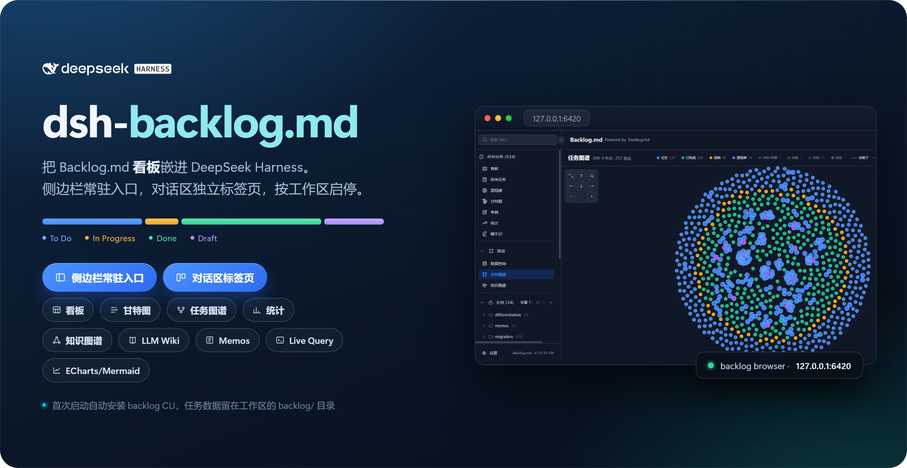
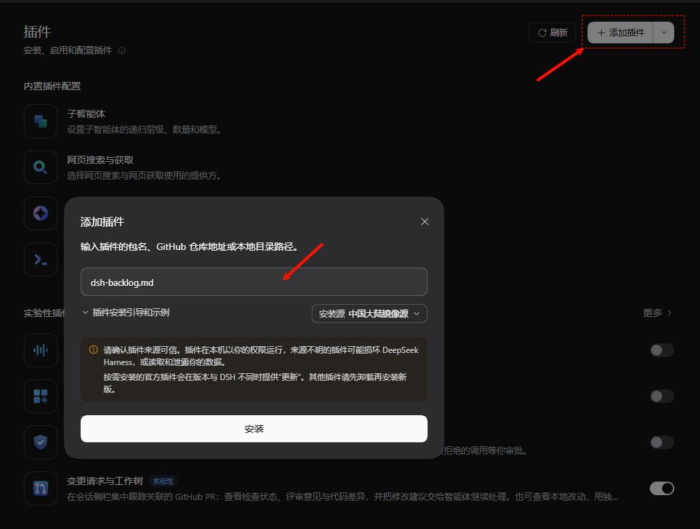
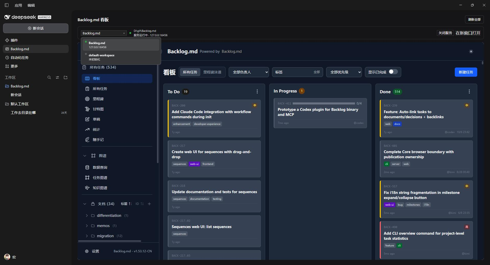
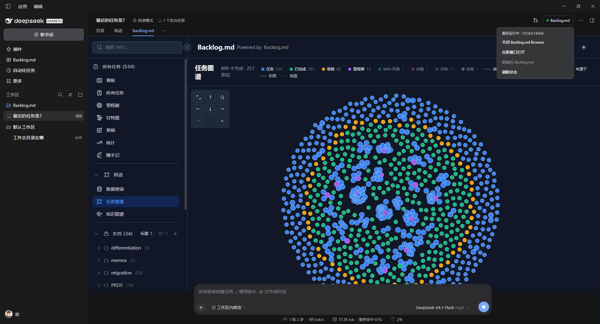
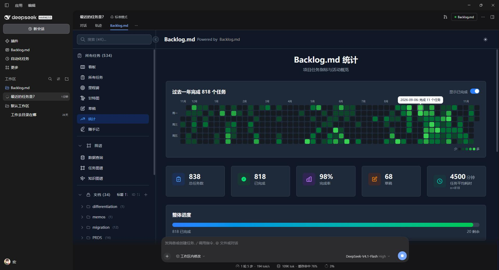

<a id="readme-top"></a>

<div align="center">

# dsh-backlog.md

### 把 Backlog.md 的 Markdown 看板嵌进 DeepSeek Harness

侧边栏面板 · 对话区标签页 · 会话头菜单，每个工作区一个独立的 `backlog browser` 进程。

[](https://www.npmjs.com/package/dsh-backlog.md)
[](https://www.npmjs.com/package/dsh-backlog.md)
[](https://github.com/kuwork/DSH-Backlog.md/blob/main/LICENSE)
[](https://nodejs.org)
[](https://github.com/kuwork/DSH-Backlog.md/stargazers)

简体中文 ｜ [English](https://github.com/kuwork/DSH-Backlog.md/blob/main/README.en.md)

[功能亮点](#功能亮点) ·
[这是什么](#这是什么) ·
[快速安装](#快速安装) ·
[截图预览](#截图预览) ·
[三个入口](#三个入口) ·
[安装方式](#安装方式) ·
[可选配置](#可选配置) ·
[工作原理](#工作原理) ·
[常见问题](#常见问题-faq) ·
[已知限制](#已知限制)

</div>



**dsh-backlog.md** 是一个 DeepSeek Harness（DSH）bundle 插件，把 Git 原生、Markdown 驱动的 AI 任务管理器 [Backlog.md](https://github.com/kuwork/Backlog.md) 的本地 Web 看板（`backlog browser`）直接嵌进 Harness 界面：侧边栏多一个 `Backlog.md` 面板，对话区多一个 `Backlog.md` 标签页，会话头多一个 `Backlog.md` 菜单。每个工作区运行独立看板进程，端口自动避让；本机缺少 `backlog` CLI 时会自动安装，无需手动准备环境，也不修改 Harness 本体任何代码。

> [!NOTE]
> npm 包：[dsh-backlog.md](https://www.npmjs.com/package/dsh-backlog.md) ｜ 插件仓库：[github.com/kuwork/DSH-Backlog.md](https://github.com/kuwork/DSH-Backlog.md) ｜ Backlog.md 仓库：[github.com/kuwork/Backlog.md](https://github.com/kuwork/Backlog.md) ｜ 官网文档：[kuwork.github.io/Backlog.md](https://kuwork.github.io/Backlog.md/) ｜ Backlog CLI：`npm i -g @kuwork/backlog.md`

## 功能亮点

- 🧩 **三个内嵌入口**：侧边栏面板、对话区标签页、会话头菜单，覆盖冷启动看板、会话内查看与进程控制三种场景，不改动 Harness 本体代码。
- 🗂️ **按工作区隔离**：每个工作区一个独立 `backlog browser` 进程与端口，启停互不影响；同一工作区重复点「启动」具备幂等性，不会产生第二个进程。
- 🚀 **CLI 零准备**：首次启动若本机找不到 `backlog`，自动执行一次 `npm install --global @kuwork/backlog.md`（约两百多 MB，随后缓存复用），装完继续启动。
- 🔌 **端口智能避让**：起始端口按工作区绝对路径哈希自然错开，被占用则顺延；同时读取进程 stdout，跟随 CLI 自行切换的实际端口，界面明确标出「端口被占用，已改用 A → B」。
- 🧭 **初始化状态可信**：只以 `backlog/` / `.backlog/` 目录作为初始化证据，读取失败时直接显示原因，绝不会把报错误报成「未初始化」。
- 🎨 **主题自动跟随**：菜单、弹窗、面板统一使用 Harness 的 `--dsw-alias-*` 设计 token 上色，亮色 / 暗色主题及切换自动适配，只注入一个 `bk-*` 类名样式表。
- 🔒 **本地优先、可审计**：不联网、不上传任何内容、不持有凭据；仓库全部可执行代码只有 `index.js` 与 `client.js` 两个文件，安装前可逐行阅读。
- ⚙️ **行为可配置**：支持自定义可执行文件路径、关闭自动安装、调整端口窗口与就绪等待预算，详见[可选配置](#可选配置)。

## 这是什么

[Backlog.md](https://github.com/kuwork/Backlog.md) 是 **Git 原生的 AI 任务管理器**：任务、验收标准、实施计划与执行记录全部以 Markdown 文件存在你自己的仓库里，AI Agent（Claude Code、Codex、Gemini CLI 等）通过 CLI / MCP 领任务并推进，人类在**任务描述、实施计划、交付结果**三个节点审查放行。

- **Markdown Native**：一个任务就是一个 `.md` 文件，没有专有数据库，可被 `git diff` / review / 归档；
- **Git Native**：`backlog/`（tasks / docs / decisions / wiki）与代码同仓版本化；
- **Local & Offline First**：数据在本地，不需要云端账号或订阅；
- **自带看板**：`backlog browser` 启动一个本地 Web UI——本插件就是把它嵌进 Harness 的对话区标签页与侧边栏。

本插件不修改 Backlog.md，只是它的**宿主 UI**：负责看板子进程的生命周期、端口分配、同源路由与界面嵌入。官网与完整文档见 [kuwork.github.io/Backlog.md](https://kuwork.github.io/Backlog.md/)。

## 快速安装

一行命令装好，刷新 DeepSeek Harness 页面即可看到入口：

```sh
dsh plugin --profile web add dsh-backlog.md
```

`backlog` CLI 会在首次启动看板时自动安装，无需手动准备。需要固定版本时写成 `dsh-backlog.md@<版本号>`。其他安装途径（GitHub、本地路径、对话内安装）见[安装方式](#安装方式)。

也可以在界面里安装：打开 `插件` 页面 → 右上角 `+ 添加插件` → 输入包名 `dsh-backlog.md` → 点「安装」，装完刷新页面（弹窗同样接受 GitHub 仓库地址与本地目录绝对路径，安装源保持默认即可）。



> [!TIP]
> 验证安装：执行 `dsh --profile web --dump-config`，输出中出现 `# == dsh-backlog.md` 配置层，且刷新页面后侧边栏出现 `Backlog.md`，即安装成功。

## 截图预览



*侧边栏 `Backlog.md` 面板不依赖会话，冷启动即可启动看板。工作区选择器每项显示状态点、名称与服务地址（如 `127.0.0.1:6486`），未配置的工作区显示「未初始化」；右侧整块内嵌所选工作区的看板，To Do / In Progress / Done 三列、筛选与「新建任务」都在 iframe 中。*



*对话区第三个标签页（对话 / 轨迹 / **Backlog.md**）里的「任务图谱」：按任务 / 里程碑 / 文档 / 决策 / Wiki 页面上色，右上角会话头菜单可查看服务状态与端口、关闭、在新窗口打开、初始化与刷新状态。*



*同一标签页里的「统计」：年度完成热力图、总数 / 已完成 / 完成率 / 草稿 / 任务平均耗时五张指标卡与整体进度条。整块标签页都是 iframe，吃满整个高度，不占用顶部空间。*

## 三个入口

| 位置 | 能做什么 |
|---|---|
| **侧边栏 `Backlog.md` 面板** | 不依赖会话。工作区选择器（每项带状态点 + 服务地址）、启动 / 关闭 / 在新窗口打开 / 初始化，下方整块显示所选看板 |
| **对话区 `Backlog.md` 标签页** | 未启动时居中显示「启动 Backlog.md Browser」；启动后整页 iframe，无顶部工具条 |
| **会话头 `Backlog.md` 菜单** | 服务状态与端口（自动换端口时标出 `A → B`）、启动 / 关闭、在新窗口打开、初始化、刷新状态；读取失败直接显示原因，不会误报成「未初始化」 |

此外还有 `backlog init` 的初始化弹窗：可配置项目名、backlog 目录、配置位置、任务 ID 前缀、AI 集成方式、写入的指令文件与 Git 开关，提交后在**当前工作区**执行。

## 安装方式

推荐方式（npm 安装）已在[快速安装](#快速安装)给出。以下三种途径适用于离线开发、源码调试等场景，四者也都可以在 `插件` → `+ 添加插件` 弹窗中完成。

<details>
<summary><b>B. 从 GitHub 安装</b></summary>

```sh
dsh plugin --profile web add github:kuwork/DSH-Backlog.md
```

本包没有构建步骤，不会触发 pnpm 的构建脚本审批。

</details>

<details>
<summary><b>C. 本地路径安装（开发调试用）</b></summary>

```sh
dsh plugin --profile web add <绝对路径>/backlog-plugin
```

</details>

<details>
<summary><b>D. 在对话里让 agent 安装（创造模式 / cordis 预设）</b></summary>

```
用 plugin_manager 的 install_bundle 安装 <绝对路径>/backlog-plugin
```

</details>

<details>
<summary><b>发版机制（维护者参考）</b></summary>

发版以 Git 标签为准：推送 `v*.*.*` 标签后，CI 按标签写版本号、发布到 npm，并把 `package.json` 同步回 `main`。npm 页面见 [npmjs.com/package/dsh-backlog.md](https://www.npmjs.com/package/dsh-backlog.md)。

</details>

## 前置条件与 CLI 自动安装

**通常不需要手动安装 `backlog` CLI。** 首次启动看板时，如果本机找不到它，插件会自动执行一次全局安装（`npm install --global @kuwork/backlog.md`，约两百多 MB，随后缓存复用），装完继续启动。只有想自己控制版本、或者机器上禁止全局安装时，才需要手动安装：

```sh
npm i -g @kuwork/backlog.md
backlog --version
```

完整 CLI 文档见 [Backlog.md 仓库](https://github.com/kuwork/Backlog.md) / [官网](https://kuwork.github.io/Backlog.md/)。

> [!WARNING]
> **已知坑（Windows 原生二进制版本不一致）**：`@kuwork/backlog.md` 通过平台专属 optionalDependency 分发原生二进制。若版本自报与二进制不一致，表现为 `backlog browser` 启动后立刻退出、无输出，请用 `npm i -g @kuwork/backlog.md --force` 重装，并确认 `%APPDATA%\npm\node_modules\@kuwork\backlog.md-windows-x64\package.json` 的 version 与 CLI 一致。自动安装失败、或想禁用自动安装，见下方[可选配置](#可选配置)中的 `autoInstall`；插件找不到 `backlog` 时会在结果中明确报错，不会静默失败。

## 可选配置

在 profile 的 `cordis.patch.yml` 里覆盖对应行的 `config`（**整行替换**，五个键要一起给）：

```yaml
- id: backlog-browser
  name: 'dsh-backlog.md'
  config:
    executablePath: 'C:\Users\you\AppData\Roaming\npm\node_modules\@kuwork\backlog.md\cli.js'
    autoInstall: true
    basePort: 6420
    portTries: 20
    readyTimeoutMs: 90000
```

| 键 | 默认值 | 说明 |
|---|---|---|
| `executablePath` | 自动解析 | `backlog` 可执行文件或 `cli.js` 的绝对路径；不填时从 PATH 解析，并把 `.cmd` shim 还原成 `node <cli.js>` |
| `autoInstall` | `true` | 首次启动时若找不到 `backlog`，自动 `npm install --global @kuwork/backlog.md` 一次；设为 `false` 则直接报错，由你自己安装 |
| `basePort` | `6420` | 端口窗口基址 |
| `portTries` | `20` | 依次尝试的端口数，全部占用后改用系统临时端口 |
| `readyTimeoutMs` | `90000` | 单次启动的就绪等待预算（首次冷启动要扫描整个仓库，较慢） |

## 工作原理

<details>
<summary><b>多工作区端口策略</b></summary>

每个工作区一个独立进程、一个独立端口：

1. 起始端口 = `basePort + hash(工作区绝对路径) % 100`，不同工作区自然错开；
2. 端口被占用就顺延试下一个，最多尝试 `portTries` 次；
3. 仍失败则交给系统分配临时端口；
4. **CLI 自己也可能换端口**：`backlog browser` 发现目标端口被占时会输出「Using temporary port 6500」并真的绑到 6500。插件因此**读取它的 stdout**，从 `Backlog.md browser interface running at http://localhost:<port>` 这行取实际端口，就绪轮询跟着这个端口走，不再死等自己请求的那个；返回结果带 `requestedPort` / `shiftedPort`，界面上标出「端口被占用，已改用 A → B」。

同一工作区重复点「启动」不会起第二个进程（幂等）；「关闭」只终止该工作区的进程；插件卸载或 Harness 退出时统一回收（Windows 上用 Job Object 杀掉整棵进程树）。

</details>

<details>
<summary><b>初始化检测规则</b></summary>

只认 `backlog/` 或 `.backlog/` 目录——项目的实际数据在那里，`backlog init` 也把 `config.yml` 写进去：

1. `backlog/` 或 `.backlog/` 下存在 `config.yml` / `config.yaml`；
2. 没有配置文件、但该目录里已经有看板内容（`tasks/`、`completed/`、`archive/`、`drafts/`、`decisions/`、`docs/`、`milestones/` 之一）——目录本身就是证据。

根目录放一个 `backlog.config.yml` **不算**初始化：它是 `backlog` 支持的一种配置位置，但单独存在并不代表这个工作区真的是 backlog 项目。只有目录存在且完全为空时才算「未初始化」。初始化完成后 Host 会再自检一次：`backlog init` 退出码为 0 却没找到配置时，会明确报错并附上 CLI 输出。

</details>

<details>
<summary><b>Host 与 Client 实现要点</b></summary>

- **Host**（`index.js`）：通过 `ctx.subprocess` 启动 `backlog browser --port <n> --no-open`，用 `ctx.webServer.register({ kind: 'prefix', path: '/backlog', … })` 挂一条前缀路由，暴露 `inspect|status|start|stop|init` 五个同源 JSON 端点（`POST /backlog/<endpoint>`）。鉴权不自做：入口调用 `ctx.connection.admit(req)`，复用 Connection 的 Host/Origin 校验与签名会话 cookie。
  两条看似可行的路都试过并记录在案：`connection.rpc.intercept('/api', …)` 会被 Gateway 既有拦截器顶掉（`shared RPC channel "/api" already has an interceptor`）；`connection.rpc.handle('/backlog', …)` 会用 **connection 服务自己的 ctx** 访问 `webServer`（而该行只 `inject: [webStartup]`），抛出 `cannot get property "webServer" without inject`。
- **Client**（`client.js`）：注册 `conversation.view`（标签页）、`conversation.session.header.utilities`（会话头菜单）、`shell.overlay`（初始化弹窗）、`main` + `sidebar.panellist`（侧边栏面板）；看板视图根元素带 `data-conversation-composer-overlay`，才能拿到确定高度放满屏 iframe。
- 主题层面，插件只注入一个 `bk-*` 类名的样式表，不改动本体 CSS。

</details>

## 常见问题 FAQ

### backlog browser 启动后立刻退出、没有输出怎么办？

这通常是 Windows 平台可选依赖的原生二进制与 CLI 版本不一致。用 `npm i -g @kuwork/backlog.md --force` 重装，并核对 `%APPDATA%\npm\node_modules\@kuwork\backlog.md-windows-x64\package.json` 的版本与 `backlog --version` 一致。详见[前置条件](#前置条件与-cli-自动安装)中的告警说明。

### 端口被占用时会发生什么？

插件先在端口窗口内顺延尝试，仍失败则用系统临时端口；如果 `backlog browser` CLI 自身也换了端口，插件会从它的 stdout 读取实际绑定端口并跟随轮询，会话头菜单会显示「端口被占用，已改用 A → B」。

### 如何关闭 CLI 自动安装？

在 `cordis.patch.yml` 的配置里把 `autoInstall` 设为 `false`（五个键需整行一起给出）。此后找不到 `backlog` 时插件会直接明确报错，由你自行安装。

### 根目录的 backlog.config.yml 为什么不算「已初始化」？

`backlog.config.yml` 只是 CLI 支持的一种配置位置，单独存在不代表工作区是 backlog 项目。插件只认 `backlog/` 或 `.backlog/` 目录及其下的 `config.yml` / 看板内容目录；目录存在且完全为空才算「未初始化」。

### Harness 以 https 提供页面时，看板区域空白？

`http://127.0.0.1:<port>` 会被浏览器的 mixed-content 策略拦截。默认 `http://127.0.0.1:3080` 提供页面时无此问题；若你的部署是 https，需要改为同源反代后才能嵌入。

### 我自己在终端启动的 backlog browser 会被接管吗？

不会。插件只管理**自己启动的**进程；手动在终端运行的 `backlog browser` 不会被接管或关闭。

### 自动安装失败会静默失败吗？

不会。找不到 `backlog` 或自动安装出错时，插件会在返回结果中附上明确报错；你也可以手动执行 `npm i -g @kuwork/backlog.md` 后再点启动。

## 已知限制

- **工作区行菜单没有扩展插槽**：`WorkspaceBrowser` 里「重命名 / 删除」是硬编码的，所以「初始化 / 关闭」放在会话头菜单和侧边栏面板里。
- **iframe 依赖目标页可被嵌套**：`backlog browser` 未发送 `X-Frame-Options`，可直接嵌入；若将来加上限制，需要改成同源反代。
- **Harness 若以 https 提供页面**，`http://127.0.0.1:<port>` 会被 mixed-content 拦截（默认 `http://127.0.0.1:3080` 无此问题）。
- 插件只管理**自己启动的**进程；你手动在终端跑的 `backlog browser` 不会被它接管或关闭。

## 安全说明

> [!CAUTION]
> 插件以**你的本机权限**运行：它会 `spawn` `backlog` 子进程、在 loopback 上起 HTTP 服务，并读写工作区里的 `backlog/` 目录。它不联网、不上传任何内容，也没有凭据。从别人仓库安装前请先通读 `index.js` 与 `client.js`——这就是仓库里全部可执行代码。HTTP 端点的鉴权复用 Harness Connection 的 Host/Origin 校验与签名会话 cookie，插件不自做鉴权。

## 文件结构

<details>
<summary>查看仓库布局</summary>

```
index.js          Host 半边：子进程生命周期、端口分配、/backlog 路由
client.js         Client 半边：标签页、会话头菜单、侧边栏面板、初始化弹窗
cordis.patch.yml  组合包补丁：向 profile 插入 backlog-browser 行
locale/*.json     中英文词典
icon.svg          插件图标
.github/*.jpg     README 用的推广图与界面截图
```

</details>

## 许可证

基于 [MIT License](https://github.com/kuwork/DSH-Backlog.md/blob/main/LICENSE) 开源。

<p align="right"><a href="#readme-top">↑ 回到顶部</a></p>
