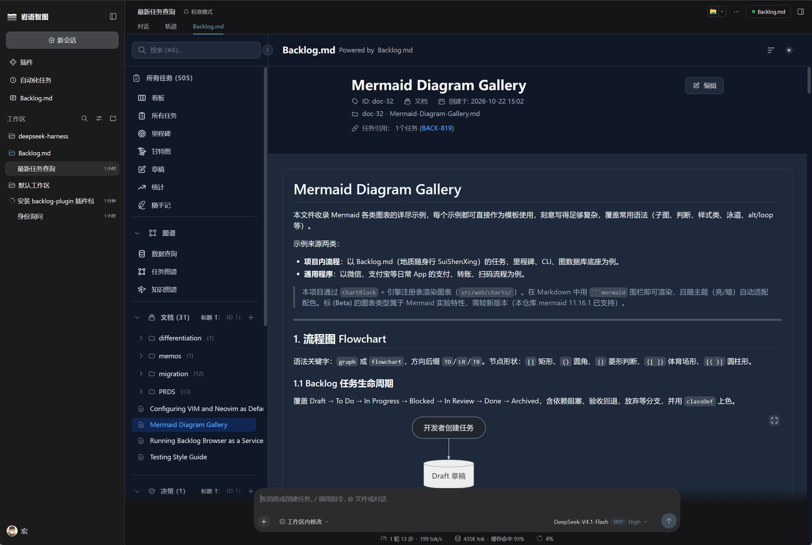

# Backlog.md Browser

[](https://www.npmjs.com/package/dsh-backlog.md)
[](LICENSE)
[](https://nodejs.org)

把 [Backlog.md](https://github.com/kuwork/Backlog.md) 的 Web 看板嵌进 **DeepSeek Harness**：侧边栏多一个 `Backlog.md` 面板，对话区多一个 `Backlog.md` 标签页，服务按工作区独立启停。

A bundle plugin that embeds the [Backlog.md](https://github.com/kuwork/Backlog.md) web board into DeepSeek Harness: a sidebar panel, a conversation-view tab, and a session-header menu, each backed by one `backlog browser` process per workspace.

> 已发布到 npm：[dsh-backlog.md](https://www.npmjs.com/package/dsh-backlog.md) · 本插件仓库：[github.com/kuwork/DSH-Backlog.md](https://github.com/kuwork/DSH-Backlog.md) · Backlog.md 仓库：[github.com/kuwork/Backlog.md](https://github.com/kuwork/Backlog.md) · 官网：[kuwork.github.io/Backlog.md](https://kuwork.github.io/Backlog.md/) · 安装 CLI：`npm i -g @kuwork/backlog.md`



*对话区第三个标签页（对话 / 轨迹 / **Backlog.md**）。看板吃满整个高度，不占顶部空间；侧边栏是同一插件的入口。*


*侧边栏 `Backlog.md` 面板。下拉里每个工作区一行两栏：状态点 + 名称，第二行是服务地址（`127.0.0.1:6486`），没有配置的显示「未初始化」。面板不依赖会话，冷启动就能启动看板。*

## 关于 Backlog.md

[Backlog.md](https://github.com/kuwork/Backlog.md) 是**Git 原生的 AI 任务管理器**：任务、验收标准、实施计划与执行记录全部以 Markdown 文件存在你自己的仓库里，AI Agent（Claude Code、Codex、Gemini CLI 等）通过 CLI / MCP 领任务并推进，人类在**任务描述、实施计划、交付结果**三个节点审查放行。

- **Markdown Native**：一个任务就是一个 `.md` 文件，没有专有数据库，可被 `git diff` / review / 归档；
- **Git Native**：`backlog/`（tasks / docs / decisions / wiki）与代码同仓版本化；
- **Local & Offline First**：数据在本地，不需要云端账号或订阅；
- **自带看板**：`backlog browser` 起一个本地 Web UI——本插件就是把它嵌进 Harness 的第三个标签页与侧边栏。

官网与文档：[kuwork.github.io/Backlog.md](https://kuwork.github.io/Backlog.md/)。本插件不修改 Backlog.md，只是它的宿主 UI。

## 三个入口

| 位置 | 能做什么 |
|---|---|
| **侧边栏 `Backlog.md` 面板** | 不依赖会话。工作区选择器（每项带状态点 + 服务地址）、启动 / 关闭 / 在新窗口打开 / 初始化，下方整块显示所选看板 |
| **对话区 `Backlog.md` 标签页** | 未启动时居中显示「启动 Backlog.md Browser」；启动后整页 iframe，无顶部工具条 |
| **会话头 `Backlog.md` 菜单** | 服务状态与端口（自动换端口时标出 `A → B`）、启动 / 关闭、在新窗口打开、初始化、刷新状态；读取失败会直接显示原因，不会误报成「未初始化」 |

还有 `backlog init` 的初始化弹窗：项目名、backlog 目录、配置位置、任务 ID 前缀、AI 集成方式、写入的指令文件、Git 开关，提交后在**当前工作区**执行。

## 前置条件

本插件只负责「嵌 UI + 管进程」，`backlog` CLI 需要单独安装。安装方式与完整文档见 [Backlog.md 仓库](https://github.com/kuwork/Backlog.md) / [官网](https://kuwork.github.io/Backlog.md/)：

```sh
npm i -g @kuwork/backlog.md@1.53.12-CN
backlog --version        # 期望 1.53.12-CN
```

> 已知坑：`@kuwork/backlog.md` 通过平台专属 optionalDependency 分发原生二进制。若版本自报与二进制不一致（表现为 `backlog browser` 启动后立刻退出、无输出），用 `npm i -g @kuwork/backlog.md@1.53.12-CN --force` 重装，并确认
> `%APPDATA%\npm\node_modules\@kuwork\backlog.md-windows-x64\package.json` 的 version 与 CLI 一致。
> 插件找不到 `backlog` 时会在结果里明确报错，不会静默失败。

## 安装

装完刷新页面。四选一：

**A. 从 npm（最简单）**

```sh
dsh plugin --profile web add dsh-backlog.md
```

npm 页：[dsh-backlog.md](https://www.npmjs.com/package/dsh-backlog.md)。发版以标签为准：推送 `v*.*.*` 标签后，CI 按标签写版本号、发布到 npm，并把 `package.json` 同步回 `main`。需要固定版本就写 `dsh-backlog.md@0.1.9`。

**B. 从 GitHub**

```sh
dsh plugin --profile web add github:kuwork/DSH-Backlog.md
```

本包没有构建步骤，不会触发 pnpm 的构建脚本审批。

**C. 本地路径（开发时用）**

```sh
dsh plugin --profile web add <绝对路径>/backlog-plugin
```

**D. 对话里让 agent 装（创造模式 / cordis 预设）**

```
用 plugin_manager 的 install_bundle 安装 <绝对路径>/backlog-plugin
```

验证：`dsh --profile web --dump-config` 里应出现 `# == dsh-backlog.md` 这一层；刷新页面后侧边栏出现 `Backlog.md`。

## 配置（可选）

在 profile 的 `cordis.patch.yml` 里覆盖该行的 `config`（**整行替换**，四个键要一起给）：

```yaml
- id: backlog-browser
  name: 'dsh-backlog.md'
  config:
    executablePath: 'C:\Users\you\AppData\Roaming\npm\node_modules\@kuwork\backlog.md\cli.js'
    basePort: 6420
    portTries: 20
    readyTimeoutMs: 90000
```

| 键 | 默认 | 说明 |
|---|---|---|
| `executablePath` | 自动解析 | `backlog` 可执行文件或 `cli.js` 的绝对路径；不填时从 PATH 解析，并把 `.cmd` shim 还原成 `node <cli.js>` |
| `basePort` | `6420` | 端口窗基址 |
| `portTries` | `20` | 依次尝试的端口数，全占用后改用系统临时端口 |
| `readyTimeoutMs` | `90000` | 单次启动的就绪等待预算（首次冷启动要扫全仓库，较慢） |

## 多工作区端口策略

每个工作区一个独立进程、一个独立端口：

1. 起始端口 = `basePort + hash(工作区绝对路径) % 100`，不同工作区自然错开；
2. 被占用就顺延试下一个，最多 `portTries` 次；
3. 仍失败则交给系统分配临时端口；
4. **CLI 自己也可能换端口**：`backlog browser` 发现目标端口被占时会说「Using temporary port 6500」并真的绑到 6500。插件因此**读它的 stdout**，从 `Backlog.md browser interface running at http://localhost:<port>` 这行取实际端口，就绪轮询也改为跟着这个端口走，不再死等自己请求的那个；返回里带 `requestedPort` / `shiftedPort`，界面上标出「端口被占用，已改用 A → B」。

同一工作区重复点「启动」不会起第二个进程（幂等）；「关闭」只终止该工作区的进程；插件卸载 / Harness 退出时统一回收（Windows 上用 Job Object 杀整棵进程树）。

## 初始化检测规则

只认 `backlog/` 或 `.backlog/` 目录——项目的实际数据在那里，`backlog init` 也把 `config.yml` 写进去：

1. `backlog/` 或 `.backlog/` 下有 `config.yml` / `config.yaml`；
2. 没有配置文件、但该目录里已经有看板内容（`tasks/`、`completed/`、`archive/`、`drafts/`、`decisions/`、`docs/`、`milestones/` 之一）——目录本身就是证据。

根目录放一个 `backlog.config.yml` **不算**初始化：它是 `backlog` 支持的一种配置位置，但单独存在并不代表这个工作区真的是 backlog 项目。只有目录存在且完全为空时才算「未初始化」。初始化完成后 Host 会再自检一次：`backlog init` 退出码为 0 却没找到配置时，会明确报错并附上 CLI 输出。

## 主题

菜单、弹窗、输入框、按钮与面板用 Harness 的 `--dsw-alias-*` 设计 token 上色（`label-primary/secondary`、`bg-layer-1/2/3`、`border-l2/l3`、`interactive-bg-hover`、`state-error-primary`），亮色/暗色主题与主题切换都自动跟随；插件只注入一个 `bk-*` 类名的样式表，不改动本体 CSS。

## 实现要点

- **Host**（`index.js`）：`ctx.subprocess` 起 `backlog browser --port <n> --no-open`，用 `ctx.webServer.register({ kind: 'prefix', path: '/backlog', … })` 自己挂一条前缀路由，暴露 `inspect|status|start|stop|init` 五个端点（同源 JSON，`POST /backlog/<endpoint>`）。鉴权不自做：入口调用 `ctx.connection.admit(req)`，复用 Connection 的 Host/Origin 校验与签名会话 cookie。
  两条看似可行的路都试过并记录在案：`connection.rpc.intercept('/api', …)` 会被 Gateway 的既有拦截器顶掉（`shared RPC channel "/api" already has an interceptor`）；`connection.rpc.handle('/backlog', …)` 会用 **connection 服务自己的 ctx** 去访问 `webServer`（而该行只 `inject: [webStartup]`）而抛 `cannot get property "webServer" without inject`。
- **Client**（`client.js`）：注册 `conversation.view`（标签页）、`conversation.session.header.utilities`（会话头菜单）、`shell.overlay`（初始化弹窗）、`main` + `sidebar.panellist`（侧边栏面板）；看板视图根元素带 `data-conversation-composer-overlay`，才能拿到确定高度放满屏 iframe。
- 未修改 Harness 本体任何代码。

## 已知限制

- **工作区行菜单没有扩展插槽**：`WorkspaceBrowser` 里「重命名 / 删除」是硬编码的，所以「初始化 / 关闭」放在会话头菜单和侧边栏面板里。
- **iframe 依赖目标页可被嵌套**：`backlog browser` 未发 `X-Frame-Options`，可直接嵌入；若将来加上限制，需要改成同源反代。
- **Harness 若以 https 提供页面**，`http://127.0.0.1:<port>` 会被 mixed-content 拦截（默认 http://127.0.0.1:3080 无此问题）。
- 插件只管理**自己启动的**进程；你手动在终端跑的 `backlog browser` 不会被它接管或关闭。

## 安全提示

插件以**你的本机权限**运行：它会 `spawn` `backlog` 子进程、在 loopback 上起 HTTP 服务、并读写工作区里的 `backlog/` 目录。它不联网、不上传任何内容，也没有凭据。从别人仓库安装前请先读一遍 `index.js` 与 `client.js`——这就是仓库里全部可执行代码。

## 文件结构

```
index.js          Host 半边：子进程生命周期、端口分配、/backlog 路由
client.js         Client 半边：标签页、会话头菜单、侧边栏面板、初始化弹窗
cordis.patch.yml  组合包补丁：向 profile 插入 backlog-browser 行
locale/*.json     中英文词典
icon.svg          插件图标
.github/*.jpg     README 用的界面截图
```
